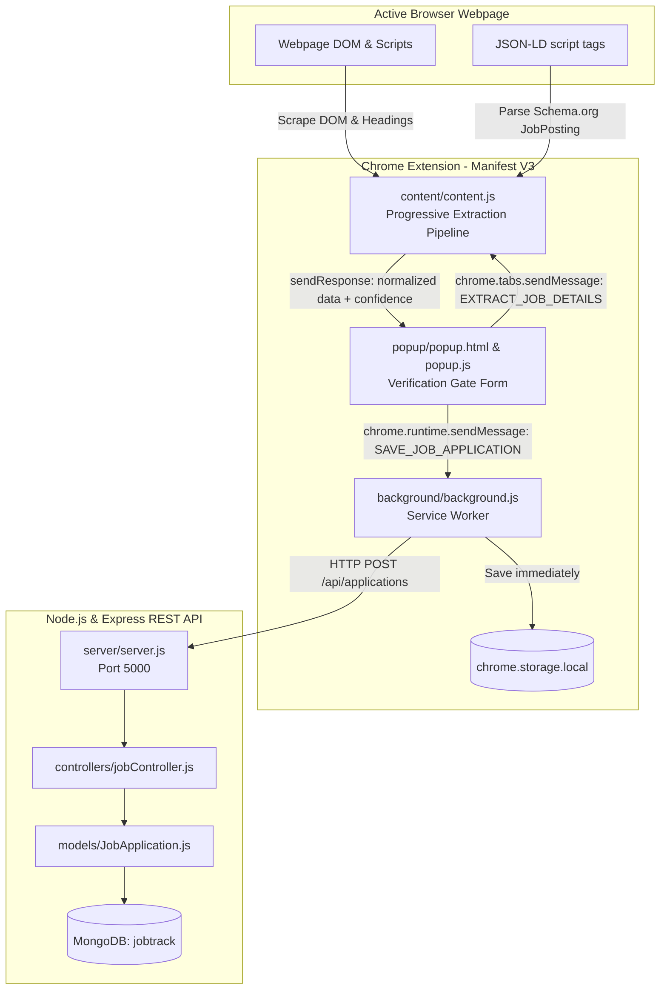

# Project Handover Documentation: JobTrack

> **Notice for the Next AI Assistant**: Read this document in its entirety before taking any action or writing code. Always inspect the active codebase before making assumptions or modifying files. Preserve working functionality, avoid re-implementing completed features, and follow the established progressive extraction and storage patterns.

---

## 1. Executive Summary

**JobTrack** is a personal job application tracking system composed of:
1. A **Google Chrome Extension (Manifest V3)** that extracts job metadata (title, company, location, salary, job type, URL) from job boards (LinkedIn, Indeed), major ATS platforms (Workday, Greenhouse, Lever, etc.), and generic career sites. It provides an interactive **Verification Gate Popup** allowing the user to review and correct data with visual confidence indicators before saving.
2. A **Node.js / Express REST API** backed by **MongoDB** (via Mongoose) running on `http://localhost:5000` that validates and upserts applications based on canonical sanitized URLs.

The architecture emphasizes **local-first reliability**: applications are saved to `chrome.storage.local` instantly, followed by an asynchronous sync to the MongoDB backend. The system works seamlessly offline and prevents data loss.

---

## 2. Project Overview, Problem Statement, and Goals

### Problem Statement
During active job searches, candidates apply to dozens or hundreds of positions across disparate platforms (LinkedIn, Indeed, corporate career portals, Greenhouse, Lever, Workday). Manually logging details (role title, company, salary, URL, application date) into spreadsheets is tedious, prone to human error, and frequently abandoned. Furthermore, automated scrapers often fail due to dynamic SPAs, authentication walls, and non-standard DOM layouts.

### Project Goals
* **Automated Data Capture**: Extract job metadata directly from the active webpage in the user's authenticated browser session.
* **Human-in-the-Loop Quality Control**: Present a "Verification Gate" popup displaying per-field and overall confidence scores, enabling the user to confirm or edit details prior to saving.
* **Resilient Multi-Layer Extraction**: Combine Schema.org JSON-LD structured data, targeted site selectors, scoped semantic heuristics, and right-to-left ATS domain parsing.
* **Dual Persistence**: Store applications immediately in local browser storage for speed and offline resilience, while syncing with a centralized MongoDB database for long-term record-keeping and querying.

---

## 3. Intended Users and Use Cases

### Intended Users
* Job seekers applying across multiple company career portals and job aggregator sites.
* Developers or power users seeking a self-hosted, private application tracking pipeline without third-party vendor lock-in.

### Key Use Cases
1. **Applying via LinkedIn or Indeed**: The user opens a job posting, clicks the JobTrack extension icon, reviews pre-filled fields (auto-extracted with ~90% confidence), selects application status (e.g., `Applied`), and clicks "Save Application".
2. **Applying via Company Career Sites (Workday, Greenhouse, Lever, etc.)**: The user navigates to a job posting on an ATS subdomain (e.g., `company.greenhouse.io/jobs/...`). The extension extracts the job title from semantic headings and parses the company name from the hostname/pathname.
3. **Offline Job Logging**: If the user saves a job while the backend server or MongoDB is offline, the record is safely saved to `chrome.storage.local` without crashing or blocking the user.
4. **Application Audit**: Querying tracked jobs via REST API endpoints (`GET /api/applications`) sorted chronologically by application date.

---

## 4. Technology Stack and Architecture

### Technology Stack
* **Browser Extension**:
  * Chrome Extensions Manifest V3
  * Vanilla JavaScript (ES2022+), HTML5, Vanilla CSS3 (custom dark glassmorphic design)
  * Chrome APIs: `chrome.storage.local`, `chrome.tabs`, `chrome.scripting`, `chrome.runtime`
* **Backend Service**:
  * Node.js (ES Module mode: `"type": "module"`)
  * Express `^4.19.2`
  * Mongoose `^8.3.1` (MongoDB ODM)
  * Middleware & Utilities: `cors ^2.8.5`, `dotenv ^16.4.5`
* **Database**:
  * MongoDB (Local instance: `mongodb://127.0.0.1:27017/jobtrack`)
* **Version Control**:
  * Git (Remote origin: `https://github.com/sowmyaperuri/jobTracker.git`)

### System Architecture Diagram



---

## 5. Complete Folder and File Structure

```
job tracker antigravity/
├── PROJECT_HANDOVER.md                 # Master project documentation (this document)
├── README.md                           # Project introduction & quick-start guide
├── extension/                          # Chrome Extension codebase (Manifest V3) [Git Root]
│   ├── .git/                           # Git repository directory (origin: jobTracker.git)
│   ├── manifest.json                   # Extension manifest (v3, permissions, content scripts)
│   ├── background/
│   │   └── background.js               # Event-driven background service worker & API sync
│   ├── content/
│   │   └── content.js                  # Injected progressive 4-layer extraction script
│   ├── popup/
│   │   ├── popup.html                  # Verification Gate modal UI
│   │   ├── popup.css                   # Dark theme design system & confidence badges
│   │   └── popup.js                    # Popup controller, retry injection, submission handler
│   ├── adapters/                       # [Orphaned/Modular Adapter definitions - see Section 9]
│   │   ├── adapterRegistry.js          # Registry matching URLs to site-specific adapters
│   │   ├── linkedinAdapter.js          # Dedicated LinkedIn CSS selectors & extraction logic
│   │   └── indeedAdapter.js            # Dedicated Indeed CSS selectors & extraction logic
│   └── utils/
│       ├── schema.js                   # Data contract factory & confidence score calculator
│       └── extractor.js                # Modular extraction engine (mirrors content.js)
└── server/                             # Node.js + Express REST API [Untracked in Git - see Section 12]
    ├── .env                            # Environment variables (PORT, MONGODB_URI)
    ├── package.json                    # Backend dependencies and execution scripts
    ├── package-lock.json               # Lockfile for backend dependencies
    ├── server.js                       # Express app bootstrap, logging middleware, routing
    ├── config/
    │   └── db.js                       # Mongoose MongoDB connection establishment
    ├── controllers/
    │   └── jobController.js            # CRUD route handlers (upsert by jobUrl, get, patch, delete)
    ├── models/
    │   └── JobApplication.js           # Mongoose schema, validation, jobUrl indexing
    └── routes/
        └── jobRoutes.js                # Express router mapping /api/applications
```

---

## 6. Detailed Explanations of Major Components

### 6.1 Progressive Extraction Engine (`content/content.js`)
Runs inside the target webpage upon receiving the message `EXTRACT_JOB_DETAILS` from the popup. Implements a 4-layer progressive fallback pipeline:

* **Layer 1: Schema.org JSON-LD Structured Data (`extractJsonLd`)**:
  * Queries `script[type="application/ld+json"]`.
  * Recursively traverses nodes or `@graph` collections for `@type: "JobPosting"`.
  * Extracts title, hiring organization / publisher, structured location (`addressLocality`, `addressRegion`), salary range/currency, and employment type.
  * Yields the highest confidence scores (~90%–95%).
* **Layer 2: Targeted Site Adapters (`runSiteAdapters`)**:
  * Evaluates when Layer 1 confidence is `< 0.85`.
  * **LinkedIn**: Targets selectors such as `h1.job-details-jobs-unified-top-card__job-title`, company anchor tags, workplace badges, easy-apply modal headers, and document title patterns (`Title | Company | LinkedIn`).
  * **Indeed**: Targets `[data-testid="jobsearch-JobInfoHeader-title"]`, company rating headers, and location badges.
* **Layer 3: Scoped DOM Heuristics & Negative Selection (`extractMetaAndHeuristics`)**:
  * Scopes search strictly to main detail containers (`main`, `[role="main"]`, `[class*="detail"]`, `[class*="job-desc"]`, `.hero-content`).
  * Explicitly excludes navigation and sidebars (`isSidebarOrNav`: checks for `aside`, `nav`, `.sidebar`, `.left-pane`, `.search-result`).
  * Filters out wizard step headers and non-job titles via `isGoodTitle` blacklist (rejects "Select Resume", "Voluntary Disclosures", "Qualifications", "Apply to", etc.).
* **Layer 4: Right-to-Left Domain Parsing (`extractCompanyFromDomain`)**:
  * Parses hostname and path for recognized ATS platforms: `greenhouse`, `lever`, `workday`, `myworkdayjobs`, `smartrecruiters`, `icims`, `taleo`, `ashbyhq`, `bamboohr`.
  * Extracts company identifiers from subdomains or path segments (e.g., `careers.company.com` or `jobs.lever.co/company`).

### 6.2 Verification Gate Popup Controller (`popup/popup.js` & `popup.html`)
* **Communication & Re-Injection Fallback**: When the popup opens, it sends `EXTRACT_JOB_DETAILS` to the active tab. If the tab was open prior to extension reload (resulting in `"Could not establish connection"`), the controller catches the error, programmatically executes `content/content.js` via `chrome.scripting.executeScript`, and retries extraction.
* **Visual Confidence Indicators**: Calculates weighted confidence via `calculateOverallConfidence()` from `utils/schema.js`. Renders high (green `>=85%`), medium (amber `>=60%`), or low (red `<60%`) badges.
* **User Review & Submission**: Renders editable inputs for `jobTitle`, `companyName`, `location`, `salary`, `jobUrl`, `appliedDate`, `status`, `jobType`, and `notes`. On form submit, sends `SAVE_JOB_APPLICATION` to `background.js` and displays a confirmation toast.

### 6.3 Background Service Worker (`background/background.js`)
* **Event-Driven Lifecycle**: Manifest V3 compliant service worker.
* **`SAVE_JOB_APPLICATION` Handler**:
  1. Calls `saveToLocalStorage(jobData)`: Upserts the application in `chrome.storage.local` under the `jobApplications` array by comparing `jobUrl`.
  2. Dispatches asynchronous `fetch('http://localhost:5000/api/applications')` with `POST` payload. If the server is offline or unreachable, catches the error and logs a warning without impeding the user.
* **`GET_ALL_JOBS` Handler**: Fetches from the REST API, falling back to `chrome.storage.local` on network failure.

### 6.4 Backend Service & Database Layer (`server/`)
* **Bootstrap (`server.js`)**: Starts Express on port 5000, attaches CORS, JSON parser, and request timestamp logger (`[HH:MM:SS] METHOD /path`).
* **Connection (`config/db.js`)**: Connects to `mongodb://127.0.0.1:27017/jobtrack` via Mongoose with graceful error handling.
* **Data Model (`models/JobApplication.js`)**: Enforces required fields, string trimming, enums for `jobType` and `status`, confidence score objects, timestamps, and creates a secondary index on `{ jobUrl: 1 }`.
* **Controllers (`controllers/jobController.js`)**: Implements idempotent upsert via `JobApplication.findOneAndUpdate({ jobUrl }, { ...req.body }, { new: true, upsert: true, runValidators: true })`.

---

## 7. Database Models, APIs, Integrations, and Data Flow

### Database Schema: `JobApplication`
```javascript
{
  jobTitle:         { type: String, required: true, trim: true },
  companyName:      { type: String, required: true, trim: true },
  location:         { type: String, default: '', trim: true },
  jobUrl:           { type: String, required: true, trim: true, index: true },
  salary:           { type: String, default: '', trim: true },
  jobType:          { type: String, enum: ['Full-Time', 'Part-Time', 'Contract', 'Internship', ''], default: 'Full-Time' },
  status:           { type: String, enum: ['Wishlist', 'Applied', 'Screening', 'Interviewing', 'Offer', 'Rejected'], default: 'Applied' },
  appliedDate:      { type: String, default: () => new Date().toISOString().split('T')[0] },
  description:      { type: String, default: '' },
  notes:            { type: String, default: '' },
  confidenceScores: {
    jobTitle:       { type: Number, default: 0 },
    companyName:    { type: Number, default: 0 },
    location:       { type: Number, default: 0 },
    salary:         { type: Number, default: 0 },
    jobUrl:         { type: Number, default: 1.0 }
  },
  createdAt:        Date, // Auto managed by timestamps: true
  updatedAt:        Date  // Auto managed by timestamps: true
}
```

### REST API Endpoints Specification

| Method | Endpoint | Description | Request Body | Success Response | Error Codes |
| :--- | :--- | :--- | :--- | :--- | :--- |
| `GET` | `/` | Health check | None | `{ status: "online", version: "1.0.0" }` | None |
| `GET` | `/api/applications` | List all applications sorted by `appliedDate: -1, createdAt: -1` | None | `{ success: true, count: N, data: [...] }` | 500 |
| `GET` | `/api/applications/:id` | Get single application by Mongo `_id` | None | `{ success: true, data: { ... } }` | 404, 500 |
| `POST` | `/api/applications` | Idempotent upsert by `jobUrl` | Full application JSON payload | `{ success: true, data: { ... } }` (201) | 400, 500 |
| `PATCH` | `/api/applications/:id` | Update existing application fields | Partial application JSON payload | `{ success: true, data: { ... } }` (200) | 400, 404 |
| `DELETE`| `/api/applications/:id` | Delete application by ID | None | `{ success: true, message: "..." }` | 404, 500 |

### URL Sanitization Pipeline
Both `content.js` and `extractor.js` run `cleanUrl()` to strip tracking queries before storing:
* Removed parameters: `utm_source`, `utm_medium`, `utm_campaign`, `ref`, `gh_jid`, `sourceId`.

---

## 8. Implemented Features

* [x] **Chrome Extension Manifest V3 Foundation**: Compliant service worker and content script configuration.
* [x] **4-Layer Progressive Extraction Pipeline**: JSON-LD structured data, targeted LinkedIn & Indeed selectors, scoped container heuristics, and right-to-left ATS domain resolution.
* [x] **Negative Heuristic Filtering**: Blacklist prevention for ATS wizard headings and navigation containers.
* [x] **Verification Gate UI**: Form pre-filling, editable fields, dynamic confidence badges, dark glassmorphism design.
* [x] **Content Script Auto Re-injection**: Overcomes stale tab connection errors seamlessly.
* [x] **Offline-First Storage**: Writes immediately to `chrome.storage.local`.
* [x] **Backend Sync**: Asynchronous POST to Express API with non-blocking error handling.
* [x] **Idempotent Mongo Upsert**: Deduplication on `jobUrl`.
* [x] **RESTful CRUD Operations**: Complete endpoint suite in Express controller.

---

## 9. Partially Implemented and Unfinished Features

### 9.1 Modular Site Adapters (Orphaned Architecture)
* **Status**: **Partially Implemented / Unused**.
* **Detail**: `extension/adapters/` contains `adapterRegistry.js`, `linkedinAdapter.js`, and `indeedAdapter.js`, and `extension/utils/extractor.js` contains a modular extraction engine. However, because Manifest V3 content scripts cannot natively import ES modules without a bundler, the developer inlined the entire pipeline into `extension/content/content.js`.
* **Action Needed**: Either set up a bundler (Vite or esbuild) so `content.js` can import from `adapters/`, or formally deprecate the files in `adapters/` to eliminate confusing dead code.

### 9.2 Application List / Management UI
* **Status**: **Missing Frontend Component**.
* **Detail**: `background.js:26-31` implements a `GET_ALL_JOBS` listener, and the backend implements `GET /api/applications`. However, the extension popup (`popup.html`) only has a "Save Active Application" form. There is no UI to view, search, filter, or delete previously saved jobs.
* **Action Needed**: Create an Application Manager UI (either a secondary tab in the popup or a full-page options dashboard).

### 9.3 Offline Sync Backfill
* **Status**: **Unfinished Logic**.
* **Detail**: When the backend server is offline, applications are saved only in `chrome.storage.local`. When the server is started, these offline applications remain in local storage and are never automatically synced to MongoDB.
* **Action Needed**: Add a `synced: boolean` flag in local storage and an automatic sync routine on extension startup.

### 9.4 Missing Job Description in Verification Gate
* **Status**: **Dropped in UI Pipeline**.
* **Detail**: JSON-LD extraction correctly extracts the job description ([content.js:113](file:///c:/Users/roope/Desktop/job%20tracker%20antigravity/extension/content/content.js#L113)), and MongoDB supports it ([JobApplication.js:45](file:///c:/Users/roope/Desktop/job%20tracker%20antigravity/server/models/JobApplication.js#L45)), but `popup.html` and `popup.js` omit the field, causing it to be discarded upon save.

---

## 10. Setup, Configuration, and Execution Instructions

### Prerequisites
* Google Chrome or Chromium-based browser (Brave, Edge).
* Node.js (version 18.0.0 or higher recommended).
* MongoDB instance running locally on `mongodb://127.0.0.1:27017` (or MongoDB Community Server / Docker container).

### Backend Setup
1. Open a terminal in `server/`:
   ```bash
   cd "server"
   npm install
   ```
2. Verify or update environment settings in `server/.env`:
   ```env
   PORT=5000
   MONGODB_URI=mongodb://127.0.0.1:27017/jobtrack
   ```
3. Start the server:
   ```bash
   # Development mode with auto-reload:
   npm run dev

   # Or standard execution:
   npm start
   ```
4. Confirm server health by navigating to `http://localhost:5000/`. You should receive:
   ```json
   { "status": "online", "message": "⚡ JobTrack REST API Server Running", "version": "1.0.0" }
   ```

### Chrome Extension Installation
1. Open Google Chrome and navigate to `chrome://extensions/`.
2. Enable **Developer mode** via the toggle switch in the top-right corner.
3. Click **Load unpacked** in the top-left corner.
4. Select the `extension/` directory (`c:\Users\roope\Desktop\job tracker antigravity\extension`).
5. The extension "JobTrack - Job Application Tracker" will appear in your extensions list. Pin it to the Chrome toolbar.

### Verifying End-to-End Execution
1. Navigate to any job posting on LinkedIn (e.g., `linkedin.com/jobs/view/...`) or Indeed (e.g., `indeed.com/viewjob?...`).
2. Click the JobTrack toolbar icon.
3. Observe the Verification Gate popup: verify that Job Title, Company, Location, and URL are pre-filled with high confidence scores.
4. Click **Save Application**.
5. Check your backend terminal log. You should see:
   ```
   [HH:MM:SS] POST /api/applications
   ✅ [JobTrack] Saved: "<Job Title>" @ <Company Name>
   ```

---

## 11. Testing, Debugging, and Deployment

### Current Testing Status
* **Automated Tests**: There are currently **no automated unit or integration tests** (no Jest, Vitest, Cypress, or Supertest configured).
* **Manual Testing Workflow**:
  * Inspect content script console: Open Chrome DevTools (`F12`) on any job page. Look for logs prefixed with `[JobTrack]`.
  * Inspect popup console: Right-click the extension icon in the toolbar and select **Inspect popup**.
  * Inspect background worker: On `chrome://extensions/`, click **service worker** under JobTrack to view background network and storage logs.
  * Inspect backend: Terminal running `server.js` displays formatted request logs.

### Production Deployment Considerations
* **Extension Packaging**: In `chrome://extensions/`, click **Pack extension** to create a `.crx` file, or upload the zip to the Chrome Web Store Developer Dashboard.
* **Backend Deployment**: Can be hosted on platforms like Render, Railway, or Heroku.
* **Environment Configuration**: Currently, the extension has `http://localhost:5000` hardcoded. Before deploying to production, a centralized config module or options page must provide a configurable API base URL.

---

## 12. Bugs, Blockers, Limitations, and Technical Debt

| Issue | Severity | Location | Description & Remediation |
| :--- | :--- | :--- | :--- |
| **Server Directory Untracked by Git** | **Critical** | Workspace root | Git was initialized strictly inside `extension/`. The entire `server/` directory is untracked. Handover via Git remote will miss the backend entirely. Fix: Re-initialize Git at the workspace root. |
| **Code Duplication** | **High** | `adapters/*` vs `content.js` | Modular adapter files duplicate logic in `content.js`. Fix: Add a bundler (Vite) to allow content script imports. |
| **Missing Offline Sync Queue** | **Medium** | `background/background.js` | Saves made when backend is down are never synced once backend starts. Fix: Implement sync queue on startup. |
| **Description Field Dropped** | **Medium** | `popup/popup.js` | Extracted description is not included in the save payload. Fix: Add hidden input or collapsible field in `popup.html`. |
| **Hardcoded API URL** | **Medium** | `background.js` & `manifest.json` | `http://localhost:5000` cannot be changed without modifying source code. Fix: Externalize to `config.js`. |
| **Status Dropdown Mismatch** | **Low** | `popup/popup.html` | Schema supports `'Rejected'`, but dropdown only has 5 options. Fix: Add `<option value="Rejected">❌ Rejected</option>`. |

---

## 13. Original Requirements and Recovered Historical Decisions

### Recovered Historical Decisions
1. **Decision: Verification Gate UI Instead of Silent Auto-Save**
   * *Rationale*: Job portal layouts change frequently, and algorithmic extraction is never 100% reliable. Forcing a human review step with confidence badges guarantees clean, accurate database entries.
2. **Decision: Idempotent Upsert Based on Canonical `jobUrl`**
   * *Rationale*: Job seekers often view the same posting multiple times. Sanitizing tracking tokens (`utm_*`) and using `findOneAndUpdate({ jobUrl }, ...)` prevents duplicate database rows.
3. **Decision: Local Storage as Primary Safety Net**
   * *Rationale*: Relying exclusively on HTTP requests to localhost would break the extension whenever the developer stops the server. Local-first storage guarantees that data is never lost.
4. **Decision: Silent Re-injection on Connection Failure**
   * *Rationale*: Chrome extensions cannot communicate with tabs that were open prior to extension reload without manual page refresh. Silently re-injecting the script removes user friction.

---

## 14. Original Future Improvement Roadmap

Recovered from code structures, partially implemented handlers, and data schemas:

1. **Phase 1: Application Dashboard UI**: Build a frontend interface to display all jobs retrieved via `GET_ALL_JOBS`, allowing filtering by status (`Applied`, `Interviewing`, `Offer`) and company.
2. **Phase 2: Offline Sync Queue**: Track sync state in local storage and retry failed API POSTs when connectivity is restored.
3. **Phase 3: Extended Platform Adapters**: Expand the adapter pattern to support Glassdoor, ZipRecruiter, and Wellfound.
4. **Phase 4: Full Status Lifecycle Tracking**: Enable transitioning jobs through interview stages and logging rejection reasons or notes.

---

## 15. Independent Recommendations, Clearly Separated from Original Plans

*(The following recommendations represent new technical improvements proposed during codebase analysis.)*

1. **Recommendation: Workspace Monorepo Unification**
   * Re-initialize Git at the root level (`c:\Users\roope\Desktop\job tracker antigravity`) and create a root `package.json` with workspace management (npm workspaces). Add both `extension` and `server` to version control.
2. **Recommendation: Build Tooling with Vite & CRXJS**
   * Adopt `vite` with `@crxjs/vite-plugin`. This allows ES module imports in content scripts, TypeScript support, automatic asset hashing, and live-reloading during extension development.
3. **Recommendation: Full-Page Extension Options Dashboard**
   * Rather than trying to cram an application manager into a 380px popup, create an `options/dashboard.html` page using a modern data table or Kanban board view. Trigger it via `chrome.runtime.openOptionsPage()`.
4. **Recommendation: Export to CSV / JSON**
   * Add a one-click export feature in the dashboard so users can backup or share their job applications as spreadsheets.
5. **Recommendation: Automated E2E & Unit Testing**
   * Add Supertest tests for backend API routes (`server/__tests__/jobController.test.js`) and Vitest tests for the extraction parser against saved offline HTML fixtures.

---

## 16. Prioritized Development Plan and Dependencies

```
┌────────────────────────────────────────────────────────────────────────┐
│ MILESTONE 1: Version Control & Infrastructure Integrity                │
│ • Re-initialize Git at workspace root to track `server/`               │
│ • Update .gitignore to exclude node_modules and .env                   │
│ • Add root README.md [COMPLETED]                                       │
└───────────────────────────────────┬────────────────────────────────────┘
                                    │
                                    ▼
┌────────────────────────────────────────────────────────────────────────┐
│ MILESTONE 2: Minor Bugfixes & UI Alignment                             │
│ • Add 'Rejected' option to popup.html status dropdown                  │
│ • Add description capture to popup.html and popup.js                   │
│ • Create config.js for extension API base URL                          │
└───────────────────────────────────┬────────────────────────────────────┘
                                    │
                                    ▼
┌────────────────────────────────────────────────────────────────────────┐
│ MILESTONE 3: Build Pipeline & Adapter Refactoring                      │
│ • Integrate Vite for extension bundling                                │
│ • Connect content.js to adapters/ and utils/extractor.js               │
│ • Eliminate duplicate code between content.js and modular files        │
└───────────────────────────────────┬────────────────────────────────────┘
                                    │
                                    ▼
┌────────────────────────────────────────────────────────────────────────┐
│ MILESTONE 4: Application Dashboard & Offline Sync                      │
│ • Build Kanban / Table Application Dashboard UI                        │
│ • Implement background.js offline sync retry worker                    │
│ • Add status update and delete capabilities to the UI                  │
└────────────────────────────────────────────────────────────────────────┘
```

---

## 17. Important Decisions and Constraints

* **Strict Constraint: Manifest V3 Execution**: Chrome enforces that background scripts run as ephemeral service workers. Do not store state in background global variables; always use `chrome.storage.local`.
* **Constraint: Content Script Isolation**: Content scripts run in an isolated execution world. They cannot access page JavaScript variables directly, but they can inspect the full DOM and parse JSON-LD `<script>` elements.
* **Security & Privacy Constraint**: Job applications contain private personal search data. All backend APIs should remain local-only by default unless user authentication is explicitly implemented.

---

## 18. Instructions for the Next AI Assistant

When continuing development on this repository:
1. **Read This Document First**: Review `PROJECT_HANDOVER.md` to understand existing component boundaries before planning edits.
2. **Inspect Code Before Proposing Changes**: Do not assume missing files. Always use file viewing tools to inspect the current state of files.
3. **Preserve Working Functionality**: The progressive extraction pipeline in `content/content.js`, the verification gate in `popup/`, and the API upsert logic in `server/` are fully operational. Do not break or discard them.
4. **Address Milestone 1 First**: Ensure `server/` is safely brought under version control before making extensive architectural modifications.
5. **Do Not Hallucinate Features**: Only build features aligned with the roadmap and requirements detailed in this document.

---

## 19. Current Development Status and Immediate Next Steps

### Current Status
* **Extension**: Extraction pipeline, Verification Gate popup, and local storage fallback are **100% operational**.
* **Backend**: Express REST API and MongoDB schema are **100% operational**.
* **Git Status**: `extension/` is committed to remote `main`. `server/` is currently **untracked**.

### Immediate Next Steps
1. **Root Git Initialization**: Move `.git` to the root directory or re-initialize at `job tracker antigravity/` so both `extension` and `server` are committed to GitHub (currently only `extension/` is committed).
2. **Fix Enum & Description**: Update `popup.html` to add `<option value="Rejected">` and preserve `description` in `popup.js`.
3. **Begin Milestone 3/4**: Design the application list/management dashboard.

---

## 20. Glossary of Project-Specific Terms

* **Verification Gate**: The extension popup modal that forces a human review step with confidence scores before any job data is saved to storage.
* **Progressive Extraction**: The 4-layer fallback strategy that attempts JSON-LD first, then targeted platform adapters, then scoped DOM heuristics, and finally right-to-left ATS domain parsing.
* **Right-to-Left Domain Parsing**: The algorithm in `content.js` that scans URL hostnames and paths backwards, removing TLDs and carrier words (`careers`, `jobs`) to identify the true company name on ATS subdomains.
* **Idempotent Upsert**: Database operation that updates an existing application if the sanitized `jobUrl` matches, or inserts a new record if it does not.
* **Confidence Score**: A floating-point number between `0.0` and `1.0` reflecting the extraction certainty for each field, calculated from source quality (JSON-LD = ~0.95, CSS Selector = ~0.88, Heuristic = ~0.50-0.75).
